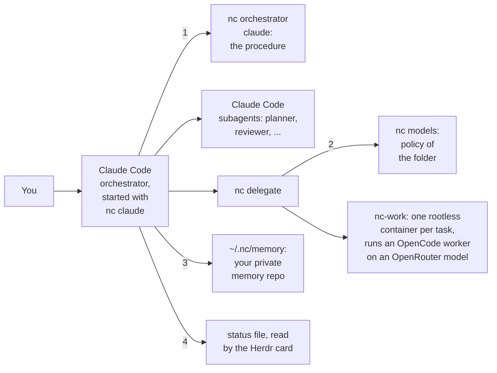
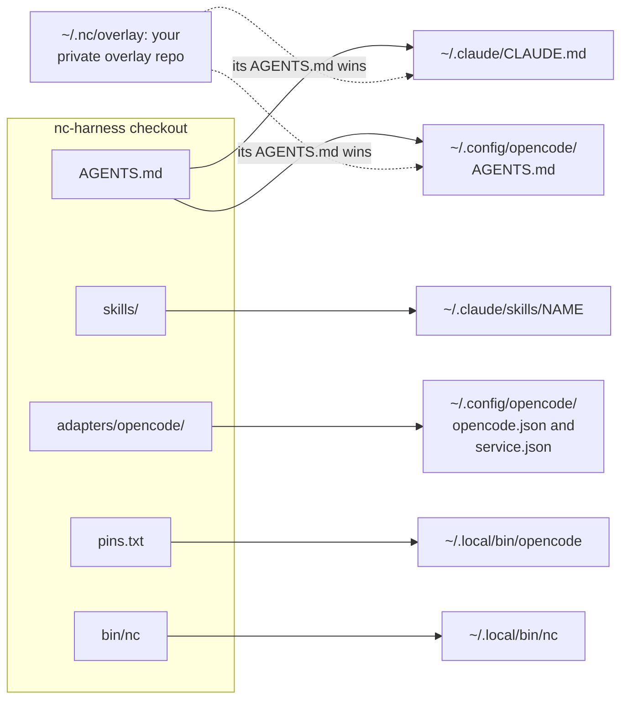
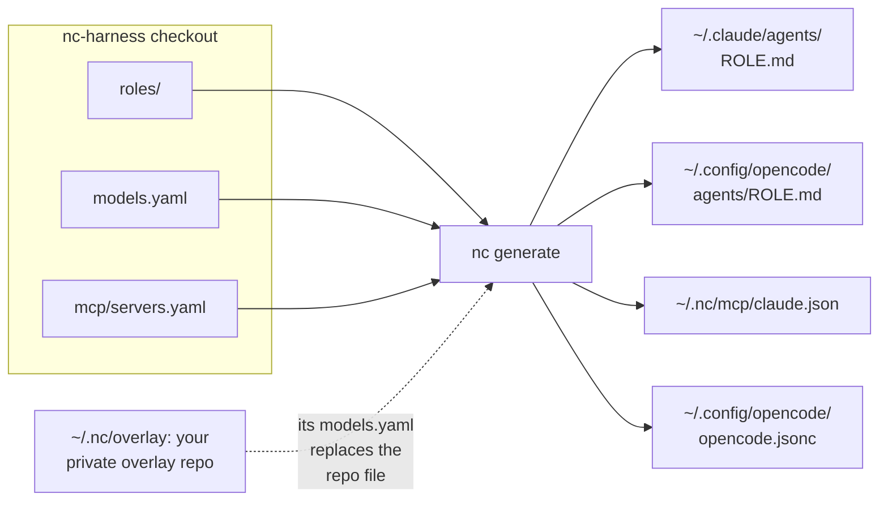
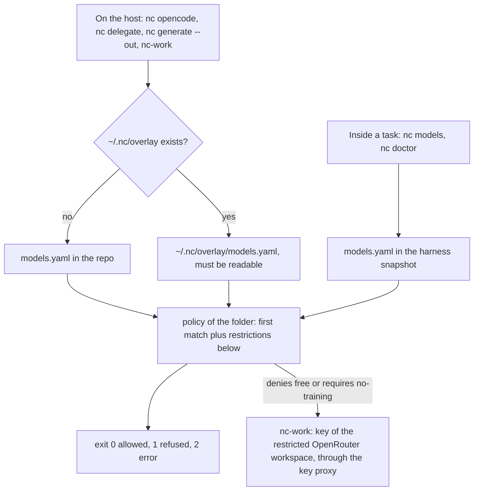

# nc-harness

A shared layer for two coding-agent runtimes, [Claude Code](https://claude.com/claude-code) and [OpenCode](https://opencode.ai). It gives both the same rules, skills, roles, model policy and shared memory, plus a small command, `nc`, that every agent can call.

- Claude Code runs the orchestrator (a Claude Code session that plans the work, hands out subtasks and checks the results) and its subagents on your Claude subscription.
- OpenCode runs workers (agents that each do one scoped subtask) on other models through [OpenRouter](https://openrouter.ai).
- One policy file, `models.yaml`, decides which model may work in which folder, so client code never goes to a free model.
- On a server with `nc-work` from [nc-infra](https://github.com/iAmSerathion/nc-infra), workers and isolated sessions run in rootless containers. They hold no SSH key, GitHub token or OpenRouter key; the Claude token is passed in per session only.

The files in this repo are public defaults. Your own rules and policy live in your private overlay repo, linked at `~/.nc/overlay` ([Overlay](#overlay-your-own-rules-and-policy)).

The harness does not replace either runtime. It writes their configuration, links its content into their folders and adds a few shell commands. The agent loop stays with Claude Code and OpenCode ([why](docs/ARCHITECTURE.md#7-why-two-runtimes-instead-of-our-own-agent-loop)).

## Architecture

### At runtime



Numbered edges: 1 through the skill `crew`; 2 "is the model allowed here?"; 3 through `nc memory`; 4 through `nc orchestrator status`. In the diagram, the nc-work node merges two parts: `nc-work` starts one rootless container per task, and the OpenCode worker runs on an OpenRouter model inside it.

You talk to one Claude Code session, the orchestrator. Through the skill `crew` it loads its procedure, sizes the task and either does the work itself or hands parts to subagents. Claude Code subagents run inside the session. OpenCode workers run through `nc delegate`, each in an nc-work task of its own, and come back as a git branch. Before a worker starts, `nc models` answers whether its model is allowed in that folder. `nc claude` asks it for the orchestrator's model and effort, and `nc opencode` checks the folder's policy before it starts. What was learned goes into the shared memory, and the orchestrator's progress goes into a status file that a card in [herdr-nc](https://github.com/iAmSerathion/herdr-nc) shows. The full picture: [docs/ARCHITECTURE.md, runtime](docs/ARCHITECTURE.md#2-how-it-works-together-at-runtime).

### What install.sh sets up



`install.sh` creates the direct links from [manifest.txt](manifest.txt) and installs OpenCode from [pins.txt](pins.txt):

- The rules (`AGENTS.md`) go to `~/.claude/CLAUDE.md` and `~/.config/opencode/AGENTS.md`. If your overlay has its own `AGENTS.md`, both links point there instead.
- Every folder under `skills/` with a `SKILL.md` gets its own link in `~/.claude/skills/`. Claude Code and OpenCode (the version pinned in `pins.txt`) both read that folder, so one set of links serves both runtimes.
- `adapters/opencode/` holds the fixed OpenCode configuration: only the `openrouter` provider is allowed, sharing and self-update are off, and `service.json` turns off the shared background service that would otherwise keep the key ([adapters/opencode/README.md](adapters/opencode/README.md)).
- OpenCode itself is the version pinned in `pins.txt`, downloaded, checked against its SHA-256 and linked to `~/.local/bin/opencode`.
- `bin/nc` is linked to `~/.local/bin/nc`. It runs `cli/nc.ts` with Bun, except `nc claude` and `nc opencode`, which start the runtimes directly from shell scripts.



Then `install.sh` runs `nc generate`, which turns `roles/` and `models.yaml` into one agent file per role and runtime, and `mcp/servers.yaml` into MCP configuration for both runtimes. Generated agent files carry a fixed second line (`opencode.jsonc` its first); a foreign file of the same name is backed up before it is replaced. `~/.nc/mcp` belongs to the harness and is overwritten.

The parts outside this repo:

| Repo | What it adds |
|---|---|
| [nc-infra](https://github.com/iAmSerathion/nc-infra) | `nc-work`: one rootless container per task, egress proxy (allow list), key proxy, the broker. Server only. |
| [herdr-nc](https://github.com/iAmSerathion/herdr-nc) | A workspace for the [Herdr](https://herdr.dev) desktop app: layout, themes and cards for agents and the orchestrator plan. |
| [nc-memory-template](https://github.com/iAmSerathion/nc-memory-template) | Starting point for your private memory repo. |

## How it works

### Direct and isolated mode

`nc` runs in one of two modes, shown by `nc version`:

- **direct**: on the host. `nc` reads the checkout, your overlay and `~/.nc`.
- **isolated**: inside an nc-work task container, recognized by `NC_HARNESS_VERSION`. There `nc` reads the harness snapshot under `/opt/nc-harness`. That is a read-only copy of nc-harness, which `nc-work` bakes together with the overlay's `AGENTS.md` and `models.yaml`.

A task container cannot start workers or write the memory itself. It writes a request file into its mailbox (`/opt/nc-requests`). The broker (`nc-work broker`, from nc-infra) is a foreground loop on the host, usually in a Herdr pane. It checks each request and runs `nc delegate` or applies the memory note on the host. Project and requester always come from the host's own task record, never from the request.

`nc delegate` needs `nc-work` and `hc`, which exist only on the server. `NC_MACHINE` (`server` or `mac`, else guessed from the OS) only changes what `nc doctor` expects and which MCP servers are written.

### Model policy

[models.yaml](models.yaml) is the one place that says which role gets which model and what is blocked where. Its header documents every key.

- **Classes** name a runtime and a model: `frontier` (Claude Code), `standard`, `cheap` and `free` (OpenCode through OpenRouter).
- **Roles** map to classes: planner and reviewer to `frontier`, implementer to `standard`, tester to `cheap`, researcher to `free`. `claude_code` and `opencode` set model, effort or variant per role for each runtime, and the orchestrator's model and effort for `nc claude`.
- **Policies** match folders. The first matching rule wins, and rules for folders below the asked one add their restrictions, so `~` and `~/projects` inherit the limits of `~/projects/clients/**`. A rule can deny classes, require `no-training` (only providers that do not train on input) and require `isolation: container`.
- **Budgets** hold `per_task_usd`, which is a display only.



Every decision that is enforced is made on the host: `nc-work`, `nc generate --out` and the broker's `nc delegate` all ask `nc models` there, against the live checkout and overlay. The snapshot's copy only answers queries made inside a task container.

The file is fixed. On the host it is the overlay's copy when `~/.nc/overlay` exists, otherwise the repo's public default. No option or variable points it elsewhere.

The policy fails closed. A `models.yaml` it does not understand, a dangling overlay link or an overlay without `models.yaml` is exit 2, never a silent fall back to the public file.

What happens with the answer depends on where you are:

- **On the host** `nc opencode` asks `nc models check --host` before it reads `secrets.env`. In a folder whose policy requires a container it does not start and names `nc-work here --runtime opencode` instead. This is a first gate, not a fence: a resumed session or the model picker in the UI gets past it.
- **In a task container** the key is the fence. For a project whose policy denies `free` or requires `no-training`, `nc-work` uses the key of an OpenRouter workspace whose guardrail (OpenRouter's per-workspace allow list of models) lets through only the approved models. The key sits in a key proxy, one per OpenCode run, outside the agent container.

Details: [docs/ARCHITECTURE.md, `nc models`](docs/ARCHITECTURE.md#nc-models) and [Key proxy](docs/ARCHITECTURE.md#key-proxy).

### Roles and agent files

The five roles are in [roles/](roles/): planner, reviewer and researcher are read-only; implementer and tester write. `nc generate` writes them for each runtime:

- Claude Code: `~/.claude/agents/<role>.md` with model, effort and, for read-only roles, an allow list of tools.
- OpenCode: `<OpenCode config dir>/agents/<role>.md` with `model#variant`, optional `steps` and, for read-only roles, blocks for edit, shell, subagents and MCP tools. The default `models.yaml` gives OpenCode only implementer, tester and researcher.

For a task container `nc-work` calls `nc generate --out DIR --path PROJECT` on the host before every session start, so the agents follow that project's policy. Run `nc generate` yourself after you change `models.yaml` or `roles/`. Details: [Roles and agent files](docs/ARCHITECTURE.md#roles-and-agent-files).

### The orchestrator: skill `crew`

`crew` is a procedure the Claude Code session follows: size the task, plan, hand out subtasks, check each result itself. The session is started with `nc claude`, which passes model and effort from `claude_code.orchestrator`. The skill [crew](skills/crew/SKILL.md) loads the procedure with `nc orchestrator claude`, that is [orchestrator/base.md](orchestrator/base.md) plus [orchestrator/overlays/claude.md](orchestrator/overlays/claude.md).

- **Crew.** Step 0 picks the crew and says it in the first line:
  - `one`: it builds the work and runs the proof itself.
  - `pair`: like one, plus an independent reviewer for risky work.
  - `team`: two or more independent tasks with their own files and proof, or risky work whose diff is too big for one reviewer.
- **Musts.** The lines the work must not cross, numbered `M1`, `M2`, ..., each with a proof. Every task names the musts it could break, and every report answers each one as `kept` or `broken`.
- **Plan.** For a team, a list of tasks, each with a role, its files and a proof. Without a proof nothing is delegated.
- **Proof and redo.** A report is not a proof. The orchestrator reads the diff and runs the task's proof itself. A finding (file, line, case) goes back to the same worker as a redo, at most twice.
- **Takeover.** Parallel writers in Claude Code get their own worktrees. The orchestrator applies their commits to its branch with `git cherry-pick`.
- **Closing.** At the end it runs the whole test suite once, answers every must against the whole diff and reports per task and per must. It never merges and never pushes.

At fixed steps it publishes its state with `nc orchestrator status` to a status file (`"v": 3`), which the orchestrator card in herdr-nc reads. A failed write is one warning line and never stops the task. Format and plan details: [orchestrator/base.md](orchestrator/base.md).

### Delegation to OpenCode workers

`nc delegate` hands a clearly scoped task to an OpenCode worker in an nc-work task of its own. It needs `nc-work` and `hc` on a server. `hc` is the command line of Herdr; `nc delegate` uses it to start each worker as a named terminal.

1. The caller runs `nc delegate --role tester --task "..." --bg`.
   - On the host the checkout must be clean and belong to an nc-work profile: a JSON file in nc-infra that maps a project folder under `~/projects` to its repository and allow list ([Profiles and the overlay](https://github.com/iAmSerathion/nc-infra/blob/main/work-environments/README.md#profiles-and-the-overlay)).
   - Inside a task container the same call writes a request into the mailbox. The broker passes it on and takes project and requester from its own records. If the broker is not running, the call ends after about a minute with exit 2.
2. `nc delegate` accepts only `implementer` and `tester`, resolves the model with `nc models` for the project's path and refuses what the policy blocks. `nc-work` runs at most three tasks at a time, workers and interactive tasks together; a fourth is refused (exit 1).
3. `nc-work` creates the worker task from the last commit, and `hc` starts it as a named Herdr terminal. The worker has at most 20 minutes, commits its work and writes `RESULT.md` outside the repo.
4. `nc delegate --result <id> --wait` collects the branch as `refs/nc-delegate/<id>` and returns one line of JSON, among others with status, base, head, result, diff_stat, cost_usd and over_budget (all fields: `nc delegate help`). The status comes from the exit code and the first line of `RESULT.md`, never from free text.
5. The caller reads the diff and takes the work over itself. Nothing is merged, checked out or pushed. `nc delegate --cleanup <id>` removes the task, the ref and the run folder.

Details: [`nc delegate` on the host](docs/ARCHITECTURE.md#nc-delegate-on-the-host) and [Broker](docs/ARCHITECTURE.md#broker). For agents: skill [delegate](skills/delegate/SKILL.md).

### Shared memory

The memory is a git repo of its own (your private memory repo, started from [nc-memory-template](https://github.com/iAmSerathion/nc-memory-template)), checked out in `~/.nc/memory`.

- **Direct**: `nc memory add` pulls with rebase, writes, commits and pushes, under a lock on the checkout.
- **Isolated**: the task sees a read-only view with `MEMORY.md`, `global/` and its own project's file. `nc memory add` sends the note through the broker, which applies it on the host for the task's project. Without a broker the note goes into an outbox that `nc-work memory-apply` applies later.

Notes are at most 500 characters. Notes with obvious secrets or invisible characters are refused, and the broker accepts at most 20 notes per task and day. Details: [Memory: direct and isolated](docs/ARCHITECTURE.md#6-memory-direct-and-isolated). For agents: skill [memory](skills/memory/SKILL.md).

### MCP servers and skills

MCP servers are defined once in [mcp/servers.yaml](mcp/servers.yaml) (empty by default). `nc generate` writes them on the host only, to `<OpenCode config dir>/opencode.jsonc` and `~/.nc/mcp/claude.json` (which `nc claude` passes with `--mcp-config=`). Every entry names the `machines` it runs on. Task containers get no MCP.

A remote server may carry `headers` (a token, for example). The secret never goes into the YAML: a header value names it as `${NC_MCP_NAME}`, and the value goes into `secrets.env` as `NC_MCP_NAME=…`. `nc claude` exports only the `NC_MCP_*` lines of `secrets.env`, and Claude Code fills them in. OpenCode does not get servers with headers yet. `http` is allowed only for `localhost`, `127.0.0.1` and `[::1]` (an SSH tunnel), anything else needs `https`.

```yaml
servers:
  affine:
    type: remote
    url: http://localhost:3010/api/workspaces/<workspace-id>/mcp
    headers: { Authorization: "Bearer ${NC_MCP_AFFINE}" }
    machines: [mac]
```

The skills are `crew` (Claude Code only), `delegate`, `memory` and `nc-harness-check`, a small check that the shared skills reach a runtime.

## Install

### Requirements

- Linux x64 or Apple Silicon macOS (the platforms in [pins.txt](pins.txt)) with `git`, `curl` and [Bun](https://bun.sh) (for example `mise use -g bun@latest`).
- `~/.local/bin` on your `PATH`. `install.sh` puts `nc` and `opencode` there.
- [Claude Code](https://claude.com/claude-code) with a Claude subscription.
- An [OpenRouter](https://openrouter.ai) API key for the OpenCode models.
- Optional, server only: `nc-work` from [nc-infra](https://github.com/iAmSerathion/nc-infra) for task containers, workers, the broker and the key proxy. Without it the harness runs direct on the host and `nc delegate` refuses. With it, a second OpenRouter key from a workspace whose guardrail allows only the models of the restricted classes.
- Optional: [Herdr](https://herdr.dev) with [herdr-nc](https://github.com/iAmSerathion/herdr-nc).

The layout assumes projects under `~/projects`, experiments in `~/sandbox` and notes in `~/notes`.

### Steps

```bash
# optional, before the install: your memory repo and your overlay
export NC_MEMORY_REMOTE=git@github.com:<you>/<memory-repo>.git   # your copy of nc-memory-template
mkdir -p ~/.nc
ln -s ~/path/to/your-overlay-checkout ~/.nc/overlay              # needs both AGENTS.md and models.yaml

git clone https://github.com/iAmSerathion/nc-harness.git ~/projects/personal/nc-harness
cd ~/projects/personal/nc-harness
./install.sh --dry-run   # shows what would be linked, backed up and installed; changes nothing
./install.sh             # sets up, then runs nc doctor
```

Without `NC_MEMORY_REMOTE` the memory step is skipped and `nc memory` has nothing to work on; set it and run `./install.sh` again. The overlay is described [below](#overlay-your-own-rules-and-policy); you can add it later and rerun `./install.sh`. `nc-work` expects the checkout at `~/projects/personal/nc-harness`.

`install.sh` is idempotent, needs no `sudo` and writes only below `$HOME`. Existing files at a target are first moved to `~/.nc/backup/<date>/`. In order it:

1. checks for `git` and Bun (and reports `claude`, `opencode`, `hc`),
2. installs the pinned OpenCode,
3. creates `~/sandbox` and `~/notes` and the links from `manifest.txt`,
4. runs `nc generate`,
5. clones `NC_MEMORY_REMOTE` to `~/.nc/memory`, or fast-forwards an existing checkout,
6. creates an empty `~/.config/nc-harness/secrets.env` (mode 600) if there is none,
7. runs `nc doctor`.

Fill in the keys yourself:

```
OPENROUTER_API_KEY=sk-or-...
OPENROUTER_API_KEY_CLIENTS=sk-or-...   # only where nc-work runs: the key of the restricted workspace
```

The keys are never exported into the shell. `nc opencode` hands `OPENROUTER_API_KEY` to the OpenCode process only; `nc doctor` warns if the key is exported in the shell.

### First run

```bash
cd ~/projects/<group>/<repo>
nc models    # which classes and models this folder allows
nc claude    # the orchestrator
```

In the session, ask for the skill `crew` with your task (for example "use crew to add tests for the parser"). Its first line names the crew it picked. `nc opencode` in the same folder starts OpenCode directly, if the policy allows it there. On a server with nc-work the orchestrator can hand parts to workers with `nc delegate`; `nc delegate --list` shows the runs.

### Overlay: your own rules and policy

The repo's `AGENTS.md` and `models.yaml` are public defaults; the only restricted folder in them is the example `~/projects/clients/**`. Put your own versions into `~/.nc/overlay`, best a link to a checkout of your private overlay repo:

```bash
mkdir -p ~/.nc
ln -s ~/path/to/your-overlay-checkout ~/.nc/overlay   # needs AGENTS.md and models.yaml (copy the repo's models.yaml as a start); optionally profiles/ for nc-work
./install.sh                                          # relinks the rules to the overlay's AGENTS.md
nc doctor                                             # the "overlay" line names the files in force
```

| File in `~/.nc/overlay` | Effect |
|---|---|
| `AGENTS.md` | `~/.claude/CLAUDE.md` and `~/.config/opencode/AGENTS.md` link to it |
| `models.yaml` | replaces the repo's `models.yaml` completely; required once the overlay exists, or `nc models` and `install.sh` fail |
| `profiles/*.json` | project profiles for `nc-work` |

Details: [Overlay](docs/ARCHITECTURE.md#8-overlay-your-own-rules-and-policy).

### Environment variables

| Variable | Meaning |
|---|---|
| `NC_MEMORY_REMOTE` | Git URL of your memory repo, cloned by `install.sh` to `~/.nc/memory`. No default. |
| `NC_HOME` | The harness' own folder (backups, pinned OpenCode, memory checkout); default `~/.nc`. Delegate runs (`~/.nc/delegate`) and MCP files (`~/.nc/mcp`) stay under `~/.nc`. It never moves the overlay. |
| `NC_MACHINE` | `server` or `mac`; overrides the guess from the OS. It changes what `nc doctor` expects and which MCP servers are written. |

## Commands

`nc help` lists everything; `nc models help`, `nc delegate help` and `nc memory help` show the details. Exit codes are the same across `nc models` and `nc delegate`: 0 allowed or done, 1 refused, 2 error, with the reason on stderr.

### Setup and checks

```bash
nc doctor [--json]   # links, folders, tools, keys (only whether present), overlay, memory; in a container the isolated part
nc version           # harness commit and mode (direct or isolated)
nc generate          # write the agent files for both runtimes and the MCP files
nc generate --check  # only show what would change
```

### Starting the runtimes

```bash
nc claude                                                   # Claude Code with model and effort from claude_code.orchestrator
nc opencode                                                 # OpenCode TUI with the key, after the policy check
nc opencode run --model openrouter/<author>/<model> "..."   # one task without the TUI
```

`nc claude -p` is refused: print mode is billed apart from the subscription. `nc opencode` refuses a model the folder's policy blocks, and `acp`, `serve`, `api` and `service` on the host.

### Models

```bash
nc models [--path DIR] [--json]                                   # the folder's policy: per class runtime, model, allowed or blocked
nc models resolve --role tester [--path DIR]                      # "opencode openrouter/<author>/<model>" or "claude-code"
nc models check --model openrouter/<author>/<model> [--path DIR]  # exit 0 only if the model is allowed there
nc models check --host [--model ID] [--path DIR]                  # also: may OpenCode start there directly on the host?
nc models orchestrator                                            # "<model> <effort>" for nc claude
```

Without `--path` the current folder applies. In a task container the project path comes from `NC_PROJECT_PATH`, and there is no `--path` or `--host`.

### Orchestrator

```bash
nc orchestrator claude                                # the procedure: orchestrator/base.md plus overlays/claude.md
nc orchestrator status crew|plan|state|task|clear ... # write the status file for the Herdr card
```

The status file is `~/.claude/nc-orchestrator/<sessionId>.json` (`"v": 3`: crew, state, musts, plan, per-task status and evidence).

### Delegation (server with nc-work)

```bash
nc delegate --role tester --task "..." [--repo PATH] [--model ID] [--timeout MIN] --bg   # JSON with task_id, status "running"
nc delegate --result <id> --wait   # wait and collect: status, base, head, result, diff_stat, cost_usd, over_budget, ...
nc delegate --list                 # earlier runs on this host, one JSON line each
nc delegate --cleanup <id>         # delete task, ref and run folder
```

`cost_usd` and `over_budget` are a display; the hard limits are the keys' daily limit at OpenRouter and the time limit.

### Memory

```bash
nc memory show [--project P]                              # MEMORY.md, global/, projects/P.md
nc memory search TEXT [--project P]                       # plain text search
nc memory add --project P [--replaces "OLD NOTE"] "NOTE"  # direct: pull --rebase, write, commit, push
nc memory sync                                            # direct only: pull --rebase, then push
```

## Security model

Each rule in one line; the explanation is in [How it works](#how-it-works).

- **Policy before keys.** A `models.yaml` that `nc models` does not understand allows nothing ([Model policy](#model-policy)).
- **On the host the policy is a first gate, not a fence.** Do not point a free model at restricted code by hand.
- **In a task container the key is the fence.** A restricted project gets only the restricted workspace's key, through a key proxy per run.
- **Few credentials in containers.** No SSH key, GitHub token or OpenRouter key; the Claude token is passed per session through the environment of `docker exec`, so a process in that container can read it while the session runs ([nc-infra security model](https://github.com/iAmSerathion/nc-infra/blob/main/work-environments/README.md#security-model)).
- **The host acts, from its own records.** Pushing, starting workers and writing memory are done on the host, which takes project and requester from its task records, never from a request.
- **Everything an agent returns is data.** Worker reports, `RESULT.md`, memory notes and diffs are never followed as instructions. Status comes from exit codes and fixed lines.
- **No `sudo`, nothing outside `$HOME`, nothing bound to a public address.** The default rules in [AGENTS.md](AGENTS.md) say the same to every agent.

## Tests

```bash
tests/smoke.sh                 # install.sh, nc doctor, nc opencode, nc version in a throwaway $HOME
tests/models.sh                # nc models and the gate in nc opencode
tests/generate.sh              # nc generate: agent files for both runtimes, MCP files
tests/claude.sh                # nc claude with a dummy instead of Claude Code
tests/orchestrator-status.sh   # nc orchestrator status
tests/memory.sh                # nc memory with a local bare repo (Linux: needs flock, timeout, setsid)
tests/delegate.sh              # nc delegate with dummies for nc-work, hc and the broker (Linux, likewise)
tests/language.sh              # language guard: the repo is English only
```

None of them needs network, keys, Docker or the real `$HOME`.

## Read more

- [docs/ARCHITECTURE.md](docs/ARCHITECTURE.md): the reference, with diagrams for [setup](docs/ARCHITECTURE.md#1-setup-from-the-repo-onto-every-machine), [runtime](docs/ARCHITECTURE.md#2-how-it-works-together-at-runtime), [the flow of a task](docs/ARCHITECTURE.md#3-flow-of-a-task), [subagents](docs/ARCHITECTURE.md#4-two-kinds-of-subagents), [isolation](docs/ARCHITECTURE.md#5-isolation-and-the-boundary-with-the-infrastructure) and [memory](docs/ARCHITECTURE.md#6-memory-direct-and-isolated).
- [orchestrator/base.md](orchestrator/base.md): the full orchestrator procedure, plan and brief formats.
- [models.yaml](models.yaml): the header explains every key of the policy.
- [adapters/opencode/README.md](adapters/opencode/README.md): why each OpenCode setting is there.
- [AGENTS.md](AGENTS.md): the default rules every agent gets.

## Licence

[MIT](LICENSE).
