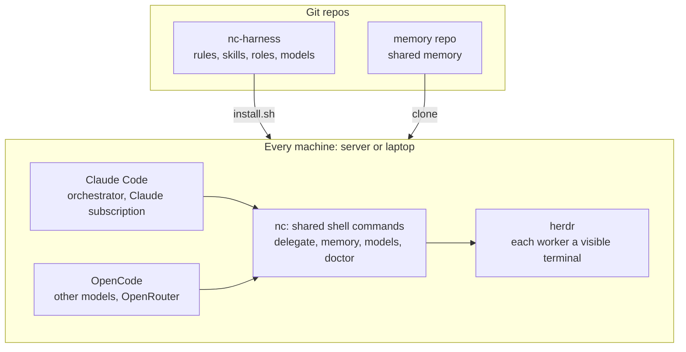
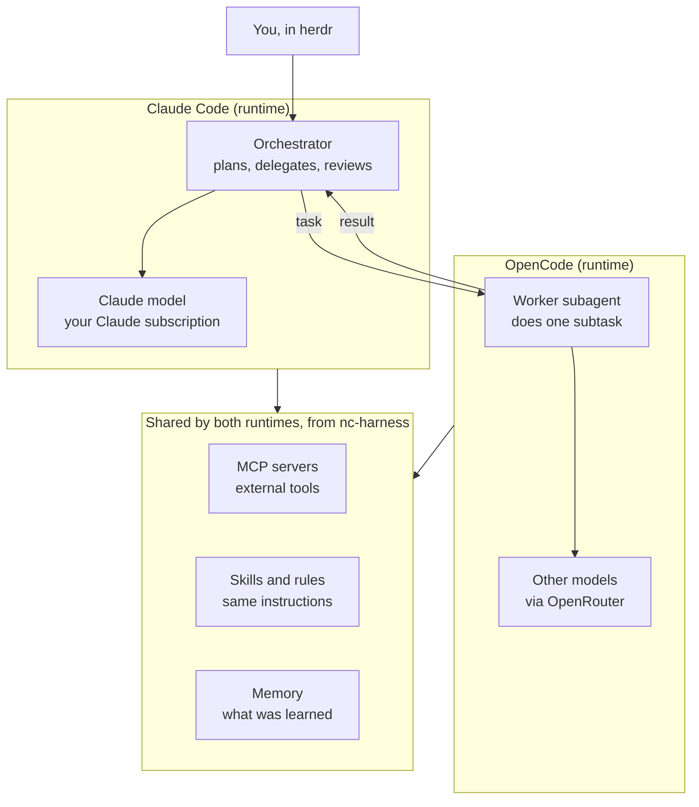
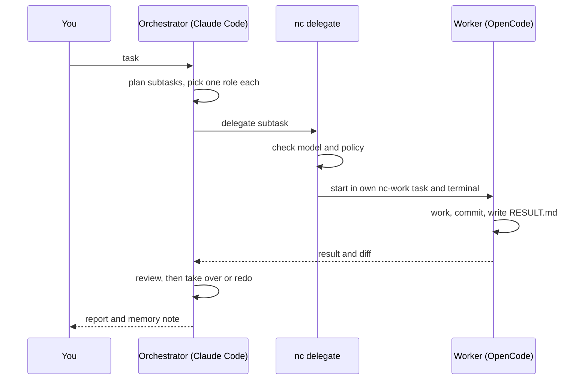
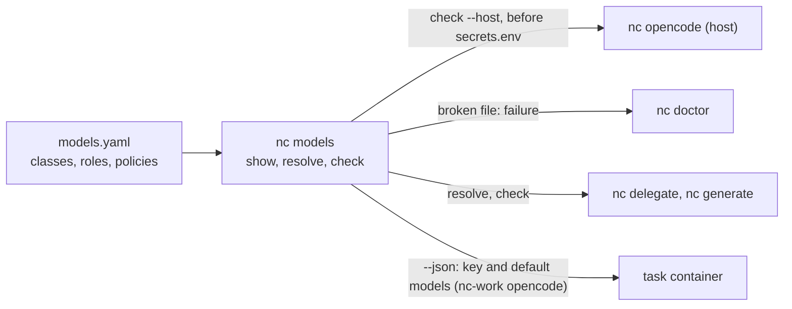
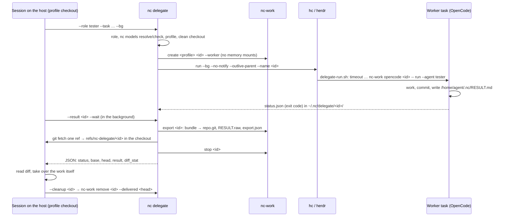
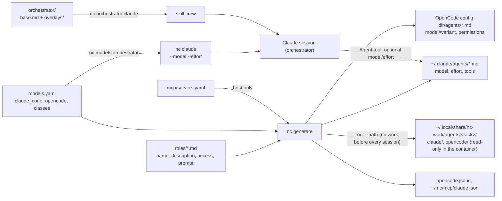
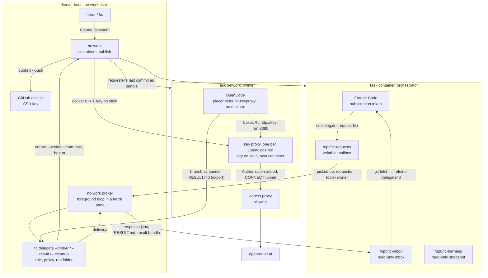
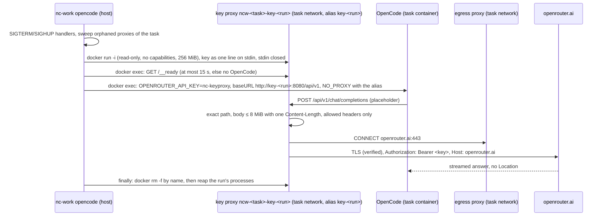
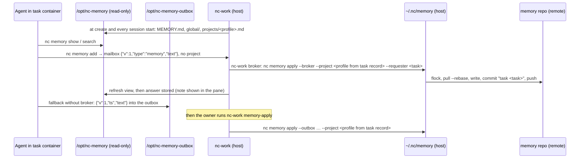

# nc-harness – Architecture

This document shows how the building blocks work together. Setup and commands are in the [README](../README.md).

## The building blocks in one sentence

| Building block | What it is |
|---|---|
| **Claude Code** | Runtime. Runs an agent, calls the Claude model, runs commands and tools. Uses your Claude subscription. |
| **OpenCode** | Runtime. Does the same for all other models, connected through OpenRouter. |
| **Orchestrator** | Role, not a program. A prompt plus a skill that runs in Claude Code only: sizes the task, plans, hands out subtasks, checks results. |
| **Worker / Subagent** | Role for a single subtask. Runs in the same runtime (native) or in the other one (delegated). |
| **MCP server** | Tool layer. Gives agents access to external things (GitHub, browser, databases). Defined once in the harness, generated for both runtimes. |
| **Skills and rules** | The same instructions for all agents: `AGENTS.md` and `skills/`. |
| **Memory** | Shared memory in a git repo of its own (`NC_MEMORY_REMOTE`), checked out in `~/.nc/memory`. |
| **`nc`** | Shell commands that every runtime can call: `delegate`, `memory`, `models`, `generate`, `doctor`, `orchestrator`, `version`; plus `nc claude` and `nc opencode` for starting. |
| **herdr / `hc`** | Shows every agent and worker as a terminal, locally and on servers. |
| **`nc-work`** | From `nc-infra`. A task is a container with its own clone of the project, without credentials and with internet only through an allow list. Interactive sessions ("Claude (isolated)") and delegated workers run in it. |

## 1. Setup: from the repo onto every machine



`install.sh` links rules and skills into both runtimes, generates the respective configurations from `roles/` (with `nc generate`) and `mcp/servers.yaml`, and clones the memory. After that every machine behaves the same.

## 2. How it works together at runtime



Important here:

- The orchestrator runs in Claude Code only, with Claude (skill `crew`). OpenCode only provides worker subagents (`implementer`, `tester`, `researcher`) and the workers of `nc delegate`.
- Orchestrator and worker have the same tools, because both runtimes use the same MCP servers, skills, rules and the same memory.
- The Claude subscription stays in Claude Code. OpenCode gets no subscription tokens.

## 3. Flow of a task



- Several workers can run at the same time. Each has its own branch in its own `nc-work` task. Workers exist only on the server; the Mac has no isolation and no `nc delegate` workers. Parallel writing subagents of Claude Code in worktrees (below) are another thing and also run on the Mac.
- `nc delegate` is the safety barrier: it asks `nc models`, picks the model for the role and aborts if the project path forbids the model (client code on a free model). Budgets are only a display: OpenCode in the worker reports `cost_usd` (`step_finish.part.cost` in `events.jsonl`), `over_budget` compares with `budgets.per_task_usd`. Costs are limited by the daily limit of the keys at OpenRouter and the time limit of 20 minutes.
- Workers never merge. They commit to their branch and write `/home/agent/.nc/RESULT.md`, outside the repo. Only the orchestrator adopts work, and only after looking at the diff.

### `nc models`

The place that reads `models.yaml` and that `nc delegate` asks before every start:



- For a folder, `nc models` determines the policy (first matching rule, plus the restrictions of the folders below it), says per class whether it is allowed there, and checks a model ID. Exit 0 is the only permission; a `models.yaml` it does not understand is an error and never an approval.
- `nc opencode` asks on the host before reading `secrets.env`. In restricted (client) folders OpenCode does not start directly, not even on a machine without `nc-work`.
- This is a first barrier, not a boundary: a start without `--model`, resumed sessions, an agent with its own model and the selection in the UI get past it; on the host it stays that way. In the container the key enforces the rule: `nc-work`, for tasks of a project that denies `free` or requires `no-training`, takes only the key of the OpenRouter workspace `clients`, whose guardrail lets through only the allowed models. The key is only in the key proxy of the run, never in OpenCode (section 5). On the host `nc opencode` still refuses `acp`, `serve` and `api`, because they get folder and model only from the client, and `service`, because `service start` starts the background service with the key. The rules are in the header of `models.yaml`.

### `nc delegate` on the host



- The worker starts from the last commit of the profile checkout in `~/projects`; a checkout with local changes is refused. Without a profile or without `nc-work`, `nc delegate` refuses (workers only on the server).
- hc starts the worker without a notification (otherwise hc would type the last output lines of the worker into the requester's session) and lets it outlive the session that started it.
- `RESULT.md` is outside the repo, so that the branch contains only the work. The status comes from the exit code and the first line, never from free text; `RESULT.md` and `diff_stat` are cleaned. Everything from the worker is data: nothing is merged, checked out or run, no normal branch is created, nothing is pushed.
- Time limit 1–20 minutes. If no end comes by the time limit plus 3 minutes, the status is `timeout`; the worker is stopped with `nc-work stop` after the export, and what was committed is fetched anyway.
- A worker task has no memory mounts and `memory-apply` skips it. From the container it goes through the broker (section 5). No researcher starts as a worker.

## 4. Two kinds of subagents

| | Native subagent | Delegated worker |
|---|---|---|
| Start | subagent function of the respective runtime | `nc delegate` |
| Runtime and model | the same runtime as the orchestrator, model and effort per role from `models.yaml` | other runtime or other model |
| Working directory | the orchestrator's; parallel writers get a Claude worktree lane (`isolation: worktree`, Mac and server) | own `nc-work` task (only on the server) |
| Visible in herdr | inside the orchestrator session | as its own terminal |
| Suited for | short support work, review, research in the same context | parallel or cheap work that changes files |

Both kinds come from the same files in `roles/`.

### Roles and agent files



- `nc generate` writes separate files for each runtime (OpenCode does not read `~/.claude/agents`). Read-only roles get a list of allowed tools in Claude Code and, in OpenCode, blocks for `edit`, `shell`, `subagent` and MCP tools (`"*_*"`). A file is recognized as generated by its second line; other files with the same name are backed up, not overwritten.
- The orchestrator is the session started with `nc claude`. It can choose a different model or a different effort per call if the user says so.
- **Orchestrator in Claude Code only:** The procedure is `orchestrator/base.md` plus `overlays/claude.md`; Claude Code fetches it through the skill `crew` with `nc orchestrator claude`. Step 0 picks the crew (`one`, `pair`, `team`). By default it uses the native subagents; parallel writers get `isolation: worktree` lanes (results taken over with `git cherry-pick`); `nc delegate` (server only) is optional. At fixed steps it publishes its state with `nc orchestrator status` to `~/.claude/nc-orchestrator/<sessionId>.json` (`"v": 3`; crew, state, musts and the plan with per-task status, proof and must answers); the herdr card `nc-orchestrator` reads it through the feed in `herdr-nc` (for isolated sessions through `nc-work feed --orch`). Writing it never stops the orchestrator. After a compaction the `SessionStart` hook with matcher `compact` (added to `~/.claude/settings.json` by `nc hooks`, which install.sh runs on the host) prints the open run from that file back into the context with `nc orchestrator status context`; there is no such hook in task containers.
- In the task, Claude reads the skill and `nc orchestrator` from the snapshot under `/opt/nc-harness`; a task with an old snapshot has neither.
- **MCP:** `mcp/servers.yaml` (empty) is generated only on the host: `opencode.jsonc` next to the linked `opencode.json`, and `~/.nc/mcp/claude.json`, which `nc claude` loads with `--mcp-config=`. In tasks there is no MCP. Read-only roles in OpenCode block MCP tools (`"*_*"`).
- On the host the files in the home folder apply in every folder; `nc models check --host` does not see them.
- For a task, `nc-work` generates them before every session start with the harness checkout on the host, according to the project's policy (in a client task no OpenCode researcher), and mounts them read-only: Claude under `~/.claude/agents`, OpenCode under `/etc/opencode/agents`. `nc-work claude` starts with the orchestrator's `--model`/`--effort`.

## 5. Isolation and the boundary with the infrastructure



### Broker

```mermaid
sequenceDiagram
  participant S as Isolated session (task container)
  participant M as Mailbox / inbox
  participant B as nc-work broker (host, herdr pane)
  participant D as nc delegate --broker (host)
  participant N as nc-work
  participant W as Worker task (OpenCode)
  S->>M: request r<time>-<hex>.json {"v":1,"type":"delegate",…}
  B->>M: heartbeat .broker every ≤10 s
  B->>B: read (O_NOFOLLOW, ≤64 KiB), stage, unlink
  B->>D: --requester/--token/--profile/--project-path from the task record
  D->>D: request checked whole, role, nc models resolve/check
  D->>N: create <profile> <id> --worker --from-task <requester>
  N->>N: requester clean? bundle HEAD, verify, fsck, base, opencode config lock (exit 4)
  D->>W: hc run … delegate-run.sh
  D-->>B: {"state":"started",…}
  B->>M: response.json started
  B->>D: --result <id> every 10 s
  W-->>D: status.json; export → delivery/ (bundle, cleaned RESULT.md, result.json)
  B->>M: RESULT.md, result.bundle, then response.json done
  S->>S: nc delegate --result <id>: fetch bundle → refs/nc-delegate/<id>
  S->>M: cleanup request → B → nc delegate --cleanup → cleaned
  S->>M: nc memory add → m<time>-<hex>.json {"v":1,"type":"memory","text":…}
  B->>B: broker_type by content; only a request it deleted itself goes on; ≤20 per task and UTC day
  B->>D: nc memory apply --broker --project/--requester from the task record (flock on ~/.nc/memory)
  D-->>B: {"state":"stored","outcome":…,"pushed":…,"note":…}
  B->>B: refresh the memory view, then response.json stored; note shown in the pane
  B->>M: dropped without an answer (full inbox, mailbox over 8): entry in .dropped → client exit 1 at once
```

- The requester is always the task that owns the folder; the token in the task record tells a new task with an old name apart from the old one. Nothing from the request determines project, path or requester.
- The worker starts from the requester's last commit and sees nothing else of it: no volume, no mailbox, no inbox, no memory. A changed OpenCode project configuration prevents the delegation.
- The broker is not a background service. If it is not running, requests stay where they are, and the client gives up after 60 seconds without a heartbeat. What it tracks is in `~/.local/share/nc-work/broker-runs/` and survives a restart.
- It also applies notes (`nc memory apply --broker`). After a restart a memory request is never taken over as a run, but answered with `error` "submit the note again"; submitting it again gives at most `refreshed` or `unchanged`.

### Key proxy



- No agent container has the key in its environment, files or memory; an agent cannot carry it off or pass it on. It is neither in `docker inspect` of the proxy nor in any Docker environment.
- As long as an OpenCode run is active, however, every process in the container of this task can use the proxy, also a Claude session: the address is in the environment of OpenCode. This is limited by the daily limit of the key, and with the `clients` key additionally by its allow list. The proxy only hides the key; the model boundary stays at OpenRouter.
- One proxy per run, also for workers and isolated OpenCode sessions; no fallback to the direct key. Offline tasks get no OpenCode.

- The containers have no credentials. Everything that has an effect outside (pushing, starting workers, writing memory) is done by the host. The OpenRouter key is only in the key proxy of a run.
- The host checks requests itself: it takes project and task from the container mapping, model and policy from `models.yaml`.
- `nc-harness`, the memory repo and `nc-infra` themselves are edited directly on the host, because they concern the machine.

| `nc-harness` | `nc-infra` |
|---|---|
| Rules, skills, roles, orchestrator | Server setup: users, firewall, Tailscale |
| Models, routing, budgets | Installing and structuring Docker |
| MCP servers, memory | Project services and port allocation |
| `nc delegate` and `nc memory`: policy, client side, format of the requests | `nc-work`: task containers, image, profiles, allow lists, broker on the host |
| `install.sh`: puts the harness layer onto a ready machine | Bootstrap: turns a fresh server into a ready machine; hosting under `/srv`, Caddy, rollout |

## 6. Memory: direct and isolated



- Directly on the host, `nc memory` works in the checkout `~/.nc/memory`: `git pull --rebase`, write, commit, push. On a conflict or uncommitted changes it aborts.
- In the task the agent sees only `MEMORY.md`, `global/` and the file of its project, read-only. Other projects and the journal do not get into the container.
- A note from the container is a request in the broker's mailbox or, without a broker, in the outbox. The host does not trust it: it takes the project from the task mapping of `nc-work`, a request with a project field or an unknown field is refused, links and special files are not read. In the outbox applied requests are deleted, refused ones stay with a `.reason` file; in the mailbox each one gets a response.
- There is no human between the container and the memory before the write, but protection instead: every note appears in the pane "Broker", the commit names the task, at most 20 new or replaced notes per task and day, only the task's own project file, a request never deletes a note, `nc memory` refuses invisible characters and obvious secrets. Reverting is done with `git revert` on the host. For the fallback, `memory-apply` still shows every request with its result and text (with `replaces` old → new, the same lines in the commit).
- All writing `nc memory` commands on the host run under `flock` on the folder `~/.nc/memory` (without `flock` installed they warn and write unlocked); `nc-work` refreshes the view under a shared lock and replaces each file atomically on its own.

## 7. Why two runtimes instead of our own agent loop

- According to Anthropic's terms, the Claude subscription may only be used in Claude Code and on claude.ai, not in third-party programs. A harness that replaces Claude Code could not use the subscription.
- OpenCode covers all other providers and reads the same skill format (also from `~/.claude/skills`). It gets the rules through its own link `~/.config/opencode/AGENTS.md`; OpenCode 2 no longer falls back to `~/.claude/CLAUDE.md`.
- The harness therefore only has to deliver the shared layer: content, generators and a few shell commands. The agent loop stays with the runtimes, which are maintained for that.

## 8. Overlay: your own rules and policy

The repo ships public defaults: a generic `AGENTS.md` and a `models.yaml` whose only restricted folder is the example `~/projects/clients/**`. Your own versions live outside the repo, in one fixed folder, `~/.nc/overlay` (usually a link to a private git checkout):

| File in `~/.nc/overlay` | Read by | Effect |
|---|---|---|
| `AGENTS.md` | `install.sh` (manifest lines with the third word `overlay`) | `~/.claude/CLAUDE.md` and `~/.config/opencode/AGENTS.md` link to it instead of the repo file |
| `models.yaml` | `nc models` on the host, and everything that asks it | replaces the repo's `models.yaml` completely |
| `profiles/*.json` | `nc-work` (from `nc-infra`) | project profiles; on the same id they win over the example profiles |

- **Fail closed.** If `~/.nc/overlay` does not exist, the repo files apply. If it exists (a folder, or a link to one), its `models.yaml` must be a readable regular file; a dangling link, a file in place of the folder, an unreadable or a missing `models.yaml` is an error (exit 2, a fail line in `nc doctor`), never a silent fall back to the public policy. `install.sh` stops on a dangling overlay link.
- **No variable moves it.** `NC_HOME` does not change where the policy comes from. `NC_HARNESS_VERSION` marks a task container, not a host setting: with it, `nc models` reads the read-only snapshot's `models.yaml` instead of the overlay. `nc models` and `nc doctor` show which file is in force.
- **Task containers.** Inside a container `nc models` reads only the snapshot's `models.yaml`. `nc-work` bakes the overlay's `AGENTS.md` and `models.yaml` into the read-only snapshot of the harness (regular files only, no links, size-capped, refused when the overlay checkout has uncommitted changes in them), so containers get the same rules and policy as the host.
